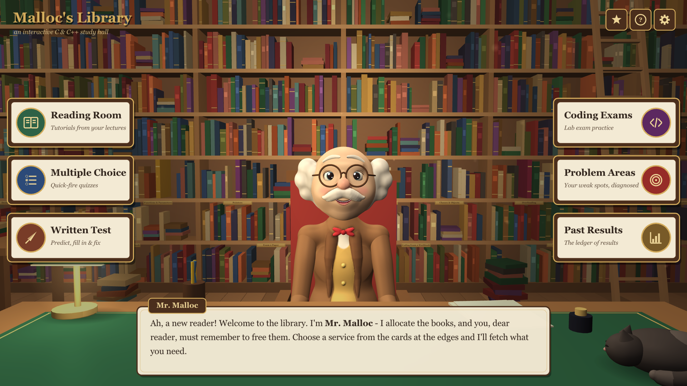
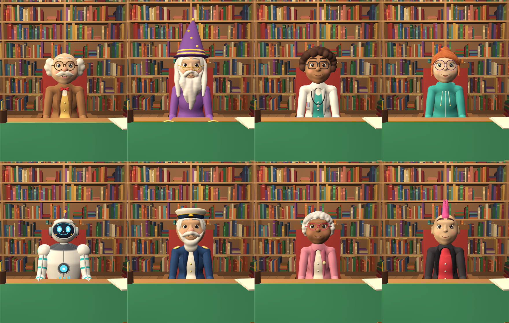

# Malloc's Library

*An interactive C & C++ study hall, written in C++17 with raylib.*

You sit at a desk in an old library, looking across it at **Mr. Malloc**, the librarian. The services are on cards around the edges of the screen. When you pick one, Mr. Malloc talks you through the options (topics, exam mixes, workbooks). Then he gets up from his chair, walks to the bookshelves behind him, takes down the right book and carries it back. He places it in front of you, the camera tilts down to the desk, and the book opens. That book is your tutorial, quiz or coding exam. When you're done you hand the book back, and he comments on how you did.



---

## What's in the library

| Service | What it does |
|---|---|
| **Reading Room** | 12 illustrated chapters written from the lecture notes. They include syntax-highlighted code, console output, **memory diagrams with pointer arrows**, tips, "Careful" warnings and *Exam focus* callouts. Each chapter has a contents page, page turning and a bookmark that remembers how far you got. |
| **Multiple Choice** | 171 questions across 12 topics, including every question from *C_Pointers_Quiz*. Take a single topic, or an **Exam 1 / Exam 2 / C++ / Everything** mix. Options are shuffled, each answer is explained right away, and you can retry the ones you missed. |
| **Written Test** | 85 questions in four styles: *predict the output*, *fill in the blank*, *find & fix the bug* and *short answer*. Spacing and case are forgiven, and you can overrule the marker ("my answer means the same"). |
| **Coding Exams** | 55 LeetCode-style problems in 3 workbooks: **Lab 1** (Coding Exam 1), the **Pointers & Linked List Lab** (Coding Exam 2), and a **C++ / STL** set. You write the function in a built-in editor. **Run** compiles it with the real compiler and runs the sample tests; **Submit** adds the hidden edge-case tests. There's also a timed **Mock Exam** (5 random problems, 60 minutes). |
| **Problem Areas** | Works out your mastery per topic from every answer and solved problem, names your weakest area, lists the questions that keep catching you, and offers a **targeted drill** of exactly those. |
| **Past Results** | A ledger of every session, with totals per workbook and a score-trend chart. |

All progress is saved in `save/` next to the program.

### The librarians
Mr. Malloc is always on duty. Seven more librarians can be earned, and once earned they are yours for good. Pick who sits at the desk under the **star button**, top right. Each has their own look, voice and way of speaking, and their own take on C and C++.



| Librarian | How to unlock |
|---|---|
| **Professor Pointer**, a wizard of addresses | finish a Reading Room chapter |
| **Dr. Heap**, lab coat and wild hair | score 100% on a multiple choice quiz |
| **Ada the Compiler**, fast and cheerful | solve a coding problem |
| **B.Y.T.E.**, a tutor robot | answer 100 questions in total |
| **Captain Stack**, last in, first out | solve 5 coding problems |
| **Nana Free**, frees everything she allocates | score 100% on a written test |
| **Kernel Panic**, pink mohawk, mostly calm | score 50% or more in a mock exam |

**For a demo:** Settings (the gear button) ends with **Developer options**. Tick **Unlock every librarian** and all eight can be called in straight away. It does not change what you have earned: untick it and the roster goes back to the librarians you unlocked yourself.

### Why the approach is different
* **Spatial and characterful.** The interface is a place you sit in, not a menu. Mr. Malloc's choreography (standing, walking, reaching for the shelf, carrying, presenting, the camera move) is all procedural animation. He speaks with a lip-synced, synthesised "mumble" voice, reacts to your results, and remembers what you did last time. The cat and the desk bell can be clicked.
* **Honest marking.** Coding answers aren't string-matched. They are compiled by MSVC and run against unit tests, with crash and infinite-loop protection. The Lab 1 *binary-to-decimal* exercise really does reject `<<` and `>>`, just like the lab sheet.
* **Exam-aligned.** Every topic is tagged Exam 1, Exam 2 or C++. The workbooks use the exact function signatures from `Lab1.cpp` and the Pointers lab, and the mock exam mirrors the lab-exam format.
* **Closed loop.** Read a chapter → the last page offers a quiz on it → wrong answers feed Problem Areas → the drill serves those questions first → re-read the weak chapter.

---

## Building and running

Requirements: Windows 10/11 and **Visual Studio 2019 or later with "Desktop development with C++"**. That's the same setup as the labs; raylib is included in `lib/` and `include/`.

```bash
build.bat
```

```bash
MallocsLibrary.exe
```

`build.bat debug` builds with a console window so you can see raylib's log. In VS Code, **Terminal → Run Build Task** runs the same script.

The Coding Exams need the C++ compiler at run time. The app finds it automatically (`cl` on the PATH, or through `vswhere`). If it can't find one, the workbooks still open and show a clear message.

### Controls
| Key | Action |
|---|---|
| Mouse | choose cards, answers and buttons; the view follows the mouse slightly |
| `Esc` | return the book / close a menu |
| `Space` or hold right mouse | hurry the librarian |
| `1-4` / `A-D` | answer multiple choice |
| `←` `→` | turn pages |
| `Ctrl+Enter` / `Ctrl+Shift+Enter` | run / submit code |
| `F11` / `F12` | full screen / screenshot (saved to `save/shots/`) |

---

## Verifying the content: `--selftest`

```bash
MallocsLibrary.exe --selftest
```

The self-test proves the answer keys are right by running them through the real compiler:

* every model solution must pass **all** of its tests (sample and hidden),
* every starter file must compile, so students start from something that builds,
* every *predict the output* MCQ (`verify: output`, 47 of them) and written question (`run: yes`, 44 of them) is compiled and run, and the program's real output must equal the answer key.

Current result: **201 / 201 checks passed**. Add a filter to test just some items, e.g. `--selftest e2.` for the Exam 2 workbook.

---

## How it works

```
src/
  main.cpp          entry point, --selftest
  app.*             the "director": phases (hub -> fetching -> presenting -> reading -> closing),
                    librarian choreography, camera blending, HUD cards, dialogue, settings/help
  scene.*           the library: procedurally built shelves, books, desk, lamp, cat, bell
  librarian.*       the librarian: procedural skeleton, poses, walk cycle, gestures, look-at, lip-sync
  librarian_draw.cpp    draws whoever is on duty: limbs, clothes details, eyes, lids, brows, mouth, glasses
  librarian_sculpt.cpp  each librarian's palette and their sculpted head, hair, torso and hands (librarian_look.h)
  sdf.*             sculpting: shapes that melt together, turned into fine meshes with baked colour and shading
  unlocks.*         the roster of librarians and the achievements that unlock them
  book3d.*          the hinged 3D book; the page UI is rendered to a texture mapped onto its pages
  gfx.*             lit GLSL shader (4 point lights, hemisphere ambient, fog), primitives, mesh batching
  ui.*              fonts, rich text (**bold**, __italic__, `code`), widgets, clipping
  dialogue.*        speech box with typewriter text and choice cards
  audio.*           procedurally synthesised voice and sound effects (no audio files)
  content.*         loads every question, chapter and problem from assets/content
  progress.*        save file, per-item history, mastery per topic, code drafts
  harness.*         turns a student's function + test list into a complete test program
  code_runner.*     finds MSVC, compiles and runs jobs on a background thread with timeouts
  syntax.*, code_editor.*   highlighting and the in-book code editor
  views/            the books: reading, MCQ, written, coding, stats (+ shared page drawing)
assets/content/     all learning content as plain text (format: assets/content/README.txt)
tools/              autopilot scripts used to record demos and verification screenshots
```

**Rendering.** Everything is generated in code: no 3D models or textures are loaded. The room is built from batched procedural meshes and lit by a custom shader with warm lamp light, fog and blob shadows. Each book's pages are an immediate-mode UI drawn into a render texture, which is then mapped onto the 3D page geometry.

**Characters.** The librarians are sculpted in code too. A head, its hair, a torso or a hand is described as a few dozen simple shapes (balls, ellipsoids, tapered locks) that melt into one another like clay; `sdf.cpp` turns that into a mesh of about 100,000 triangles with colour and soft shading baked in, in roughly a tenth of a second on first use. The parts that move (eyes, eyelids, brows, mouth, glasses) are drawn on top every frame.

**Running student code.** `harness.cpp` builds one program: the prelude headers, any given support code, the student's code (with `#line` so compiler errors point at *their* line numbers), then a `main` that runs each test. Tests report back over stdout using a small protocol. Crashes are caught with structured exception handling, and each test has a time limit, so a null-pointer crash or an infinite loop fails just that test with a readable message. `code_runner.cpp` captures the Visual Studio environment once, compiles each job in its own folder, and retries if antivirus briefly locks a freshly written file.

**Content is data.** Questions, chapters and problems are plain text files (`assets/content/`), documented in `assets/content/README.txt`. New material needs no recompiling, and the self-test checks it.

### Autopilot (demo and screenshot scripts)
```bash
MallocsLibrary.exe --script tools/shots_coding.txt
```
Scripts drive the real app (open a service, pick choices, answer, run code, turn pages) and save screenshots to `save/shots/`. `shots_coding`, `shots_mcq`, `shots_written`, `shots_reading` and `shots_misc` cover every service; `shots_demo_unlock` clicks through the developer option (run that one with `--sandbox`). They're handy for recording a screencast without fumbling. Note that scripts use the real save file, so they add sessions to the ledger. The `quick` command also turns on *Quick fetch* in Settings. Add `--sandbox` to run a script without writing your progress or code drafts (screenshots are still saved):

```bash
MallocsLibrary.exe --sandbox --script tools/shots_coding.txt
```

---

## Content sources
Built from the module material: *Intro to C*, *Pointers*, *Lecture on Pointers in C++ and linked lists*, *Pointers & LinkedList lab*, *memory management and pointers*, *Classes*, *Operator Overloading*, *templates and stl*, *STL Lists and Maps*, *C_Pointers_Quiz* and *Lab1.cpp*.

| Topic | Exam | MCQs | Written | Reading |
|---|---|---|---|---|
| C Basics | 1 | 14 | 8 | ✓ |
| Decisions & Loops | 1 | 12 | 8 | ✓ |
| Arrays & Strings | 1 | 12 | 7 | ✓ |
| Functions & Parameters | 1 | 10 | 6 | ✓ |
| Pointers | 2 | 29 | 8 | ✓ |
| Memory Management | 2 | 16 | 8 | ✓ |
| Linked Lists | 2 | 12 | 7 | ✓ |
| Classes & Objects | 2 | 17 | 7 | ✓ |
| Overloading | C++ | 11 | 6 | ✓ |
| Templates | C++ | 9 | 6 | ✓ |
| STL Vector & Iterators | C++ | 14 | 7 | ✓ |
| STL List & Map | C++ | 15 | 7 | ✓ |

Plus 55 coding problems: 24 from Lab 1, 15 from the Pointers & Linked List lab, and 16 C++ / STL problems.

raylib is © Ramon Santamaria, zlib licence (`lib/raylib-LICENSE.txt`).

---

## Three editions

The same app exists in three self-contained editions. Each one has its own source, content, raylib and build script,
so any one of them can be copied to another computer on its own.

| Edition | Where to find it | Look |
|---|---|---|
| **3D** | the current files of this repository | a first-person 3D library with a real 3D librarian, book and lighting |
| **8-bit** (V1) | commit [`877f74b`](https://github.com/RyanLowry1/C_Cpp_Learning_App/tree/877f74b39cdf8c82632be1d77adec0a2a08945f4) | chunky pixel art: a 540-pixel canvas, a 40-colour dithered palette, a bitmap font, chiptune sound |
| **2D** (V2) | commit [`a4fa738`](https://github.com/RyanLowry1/C_Cpp_Learning_App/tree/a4fa738886be29f51b15d3b46a3bf6a43e7bd7b6) | a polished 2D illustration: a vector-painted, lit set, a puppet librarian, parallax, a zooming camera |

All three use the same lessons, quizzes and coding exams and the same marking (`--selftest` passes 201 / 201 in each).
The 8-bit and 2D editions are earlier versions in this repository's history. Each link opens that edition's files, with
its own README and build instructions; **Code → Download ZIP** on that page downloads it.
